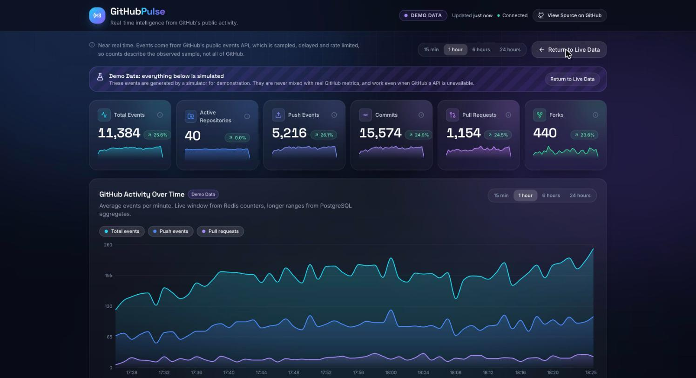
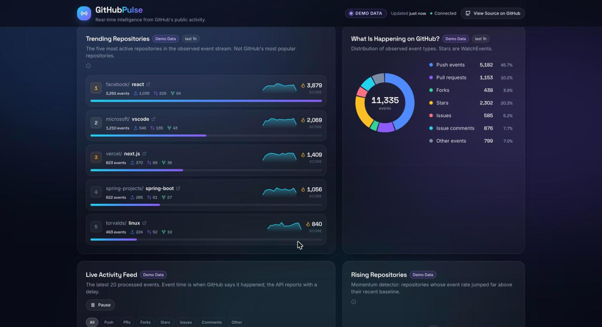
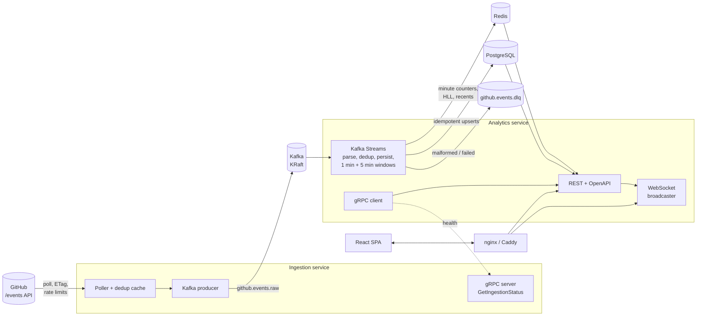

# GitHubPulse

**The internet's open-source activity, live.** GitHubPulse is a single-page analytics dashboard that watches GitHub's public event stream in near real time and turns it into KPIs, trends, trending repositories and activity-spike detection.

Behind the UI sits a small distributed system: a polling ingestion service, Apache Kafka, a Kafka Streams processor, Redis for the live window, PostgreSQL for history, and WebSockets pushing updates to the browser.

| | |
|---|---|
|  |  |

*Screenshots show the built-in **Demo Data** mode (simulated events). Live mode shows real GitHub events.*

## What it does

- **Network Graph (landing page)**: an interactive graph of repositories, developers and events built from the live WebSocket stream. Zoom, pan and drag; click a node to see its details in a side panel. Click a repository to expand its developers and events. The graph updates incrementally and is capped at 60 repositories, 120 developers and 200 events. Everything below is on the **Analytics** tab.
- **Five live KPI cards**: total events, active repositories, push events, pull requests, forks. Each has an animated number, a sparkline, the percent change, and an explanatory tooltip. The change compares the selected window with the previous equivalent one; while less history exists it compares the latest minutes with the span before them and says so in the tooltip.
- **Activity chart**: events per minute (total, push, pull request) with series toggles and 15 min / 1 h / 6 h / 24 h ranges. The live window comes from Redis counters, longer ranges from PostgreSQL aggregates.
- **Trending Repositories**: the five most active repositories in the observed event stream, ranked by a documented, configurable activity score.
- **What Is Happening on GitHub?**: event type distribution (donut with counts and percentages).
- **Live Activity Feed**: the latest 20 processed events with pause/resume and type filters.
- **Rising Repositories**: a momentum detector built on Kafka Streams windowed aggregations that flags repositories whose event rate jumps far above their recent baseline.
- **Pipeline Health**: ingestion status fetched over gRPC, stream processor state, Redis, PostgreSQL and consumer lag.
- **Demo mode**: *Launch Demo Activity* runs a server-side simulator (pushes, pull requests, forks, stars, spikes across 40 repositories). It is labelled **Demo Data** everywhere, is held in memory, and is never mixed with real metrics. It works even when GitHub's API is down.

### Honest data

GitHubPulse only claims what the data supports:

- Events come from `https://api.github.com/events`, a **sampled, delayed and rate-limited** view of GitHub. Numbers describe the *observed sample*, not all of GitHub.
- "Trending" means *most active in the observed event stream*, not GitHub's most popular repositories.
- Spikes are *activity spikes in the observed sample*, not global trends. No percentage is shown when the baseline is zero or tiny.
- **There is no Commits card.** GitHub's events API no longer includes commit counts in `PushEvent` payloads (verified against the live API), so the dashboard does not show one rather than invent a number. The `/api/metrics` response still carries a `commits` field that is empty when unavailable.
- Percent change needs at least 6 minutes of observed data (two 3-minute spans); before that no percentage is shown.

## Architecture



**Data flow.** The ingestion service polls GitHub (respecting `X-Poll-Interval`, ETags and rate-limit headers), skips IDs it has already published, and writes each new event to `github.events.raw`, keyed by event ID. Kafka Streams parses and classifies events (malformed ones go to the DLQ without stopping the stream), deduplicates by event ID in a state store, persists each event idempotently, and runs three windowed aggregations: 1-minute totals, 1-minute per repository, and 5-minute per repository (feeds the momentum detector). Window results are written as absolute values to PostgreSQL and Redis. The analytics service serves them over REST and pushes batched snapshots every 3 seconds over WebSocket.

**gRPC** is used where a synchronous request/response fits: the analytics service asks the ingestion service for its health (`GetIngestionStatus`, see [`proto/src/main/proto/ingestion.proto`](proto/src/main/proto/ingestion.proto)). Event delivery stays on Kafka.

More detail (time semantics, delivery guarantees, Redis layout, WebSocket protocol) is in [`docs/architecture.md`](docs/architecture.md).

## Technology

| Area | Stack |
|---|---|
| Frontend | React 18, TypeScript, Vite, Tailwind CSS, shadcn/ui-style components (Radix), Recharts, Cytoscape.js and d3-force (network graph), Lucide, Framer Motion |
| Backend | Java 21, Spring Boot 3.5, Apache Kafka + Kafka Streams, Redis, PostgreSQL 16, Spring Data JPA + JDBC, Flyway, WebSockets, gRPC, springdoc OpenAPI, Gradle |
| Infrastructure | Docker, Docker Compose, Terraform (AWS EC2), nginx, Caddy (optional HTTPS), GitHub Actions |
| Testing | JUnit 5, Mockito, Kafka Streams `TopologyTestDriver`, embedded PostgreSQL, Testcontainers, Vitest |

## Repository layout

```text
.
├── frontend/                      React single-page dashboard
├── services/
│   ├── ingestion-service/         polls GitHub, publishes to Kafka, serves gRPC status
│   └── analytics-service/         Kafka Streams, Redis, PostgreSQL, REST, WebSocket, demo simulator
├── proto/                         protobuf contract (Java classes generated by Gradle)
├── infrastructure/terraform/      AWS: VPC, security group, EC2, EBS, Elastic IP
├── docker/                        Dockerfiles, nginx.conf, Caddyfile
├── scripts/                       run-local.sh, load-test.sh
├── docs/                          architecture, deployment, load testing, screenshots
├── docker-compose.yml
└── .env.example
```

## Quick start with Docker Compose

Requires Docker with the Compose plugin.

```bash
cp .env.example .env            # set POSTGRES_PASSWORD; GITHUB_TOKEN is optional
docker compose up --build       # or: scripts/run-local.sh
```

Open <http://localhost:8088>. Swagger UI is at <http://localhost:8088/swagger-ui.html>.

Only the frontend container publishes a port. Kafka (KRaft mode), Redis, PostgreSQL and gRPC are reachable only on the internal Compose network.

**GitHub token (optional).** Without a token GitHub allows 60 requests per hour, so the poller reads one page (100 events) per minute. With a token (a classic or fine-grained token with no scopes) it reads three pages per minute and has a 5000/hour budget. The token is read from `GITHUB_TOKEN` only and is never written to disk by the application.

### HTTPS

Set `DOMAIN=pulse.example.com` in `.env`, point the DNS A record at the host, and run `docker compose --profile https up -d --build`. Caddy obtains and renews a certificate automatically.

## Local development without Docker

Prerequisites: JDK 21+, Node 22+, and Kafka (KRaft), Redis and PostgreSQL running locally. On macOS:

```bash
brew install kafka redis postgresql@16
brew services start kafka redis postgresql@16
createuser githubpulse && createdb -O githubpulse githubpulse
psql postgres -c "ALTER USER githubpulse WITH PASSWORD 'githubpulse';"
```

Then, in three terminals:

```bash
./gradlew :services:analytics-service:bootRun        # http://localhost:8080
./gradlew :services:ingestion-service:bootRun        # gRPC on :9090
cd frontend && npm install && npm run dev            # http://localhost:5173 (proxies /api and /ws)
```

Defaults (hosts, ports, credentials) are in each service's `application.yml` and can be overridden with environment variables, see [`.env.example`](.env.example).

## Deploying to AWS with Terraform

The Terraform configuration in [`infrastructure/terraform`](infrastructure/terraform) provisions one EC2 instance (Docker Compose), a dedicated VPC, a security group that exposes only ports 80/443, an encrypted persistent data volume, an Elastic IP and an SSM role (no SSH by default).

```bash
cd infrastructure/terraform
cp terraform.tfvars.example terraform.tfvars   # edit
terraform init
terraform plan
terraform apply                                # creates billable resources, review the plan first
```

Cost estimates, HTTPS setup, operations and **cleanup (`terraform destroy`)** are in [`docs/deployment.md`](docs/deployment.md). Nothing is provisioned automatically by this repository.

## Frontend on Vercel

The React app can be hosted on Vercel while the backend runs on a Docker host. `frontend/vercel.json` configures the build; the required environment variables (`VITE_API_BASE_URL`, `VITE_WS_URL`) and the CORS setting are in [`docs/vercel.md`](docs/vercel.md).

## API

Interactive documentation: `/swagger-ui.html` (OpenAPI JSON at `/v3/api-docs`).

| Endpoint | Purpose |
|---|---|
| `GET /api/metrics?range=1h&mode=live` | Six KPIs with sparklines and period-over-period change |
| `GET /api/activity?range=1h` | Events per minute: total, push, pull request |
| `GET /api/activity/breakdown?range=1h` | Event type distribution |
| `GET /api/repositories/trending?range=1h` | Top five repositories by activity score |
| `GET /api/repositories/rising` | Momentum detector output |
| `GET /api/events/recent?limit=20` | Latest processed events |
| `GET /api/system/status` | Ingestion (gRPC), stream processor, Redis, PostgreSQL, lag |
| `POST /api/demo/start` | Start the demo simulator |
| `WS /ws` | Live updates, see [`docs/architecture.md`](docs/architecture.md#websocket-protocol) |

`range` is one of `15m`, `1h`, `6h`, `24h`. `mode` is `live` (default) or `demo`.

**Activity score** (weights configurable through `SCORE_WEIGHT_*`):

```
score = push x 2 + pull requests x 3 + forks x 2 + other events x 1
```

## Testing

```bash
./gradlew test                  # all backend tests
cd frontend && npm test         # frontend unit tests
cd frontend && npm run typecheck
```

| Area | How it is tested |
|---|---|
| Event parsing and classification | `EventParserTest` (types, malformed payloads, unknown commit counts) |
| Kafka processing | `PulseTopologyTest` with `TopologyTestDriver`: per-minute counts, per-repository aggregation, DLQ routing, persistence retry |
| Deduplication | topology test (same event ID delivered repeatedly counts once), `EventDeduplicatorTest`, PostgreSQL primary key |
| Minute aggregations | topology and PostgreSQL tests (absolute, never-decreasing upserts) |
| Repository ranking | `DashboardServiceTest` (documented score, top five, share) |
| Momentum detection | `MomentumRulesTest`, topology spike tests (including zero/small baseline) |
| Database persistence | `PersistenceIT` against an embedded PostgreSQL with the real Flyway migrations |
| REST endpoints | `DashboardControllerTest` (`@WebMvcTest`) |
| gRPC | in-process server tests on both sides |
| WebSocket messages | `WebSocketMessagingTest` (envelope format, subscribe handling) |
| Kafka end to end | `KafkaPipelineIT` against a real broker via Testcontainers (skipped automatically when Docker is unavailable; `-Pit.kafka=host:port` points it at an existing broker) |

### Load test

```bash
./gradlew :services:analytics-service:loadTest -Pargs="--events 20000"
```

It measures end-to-end throughput, event latency over REST and WebSocket, API latency percentiles and consumer lag, and writes `scripts/results/loadtest.json`. Measured results from a development laptop are in [`docs/load-testing.md`](docs/load-testing.md).

## Engineering trade-offs

- **Observation time over event time.** Windows use the Kafka record timestamp (when the event was published), not GitHub's `created_at`. GitHub's feed lags reality by seconds to minutes, so event time would make every record "late". The cost: charts show when events were *observed*. Late-arrival handling is a 30 s grace period.
- **At-least-once with idempotent sinks, not exactly-once.** Producers are idempotent, consumers commit after processing, deduplication happens in the stream (state store), in the producer (LRU cache) and in PostgreSQL (primary key), and aggregate writes are absolute upserts that never decrease. End-to-end exactly-once is *not* claimed: a crash between persisting an event and updating its window can drop that event from an aggregate.
- **One shared raw topic** for the MVP. It keeps ordering and operations simple; per-type topics would help only at much larger volume.
- **Redis is a speed layer.** Counters expire after 26 hours; PostgreSQL is the durable record and serves every range above one hour.
- **One PostgreSQL insert per event.** Simple and idempotent, and the measured bottleneck (see load test). Batching would raise throughput at the cost of retry granularity.
- **Single EC2 instance, no Kubernetes.** Cheap and easy to reason about. It is a single point of failure; see limitations.
- **Raw WebSocket instead of STOMP**, with a small typed JSON envelope. One computation per distinct (mode, range) per tick is shared by all clients watching it.
- **Demo data lives in process memory**, completely outside Kafka, Redis and PostgreSQL, so it cannot contaminate real metrics.

## Known limitations

- The events API is a **sample**: roughly 100 to 300 events per minute out of far more on GitHub, with delays. Rankings among repositories that each have one or two events are essentially arbitrary.
- **Commit counts are unavailable** from GitHub's events API, so there is no Commits card.
- Spike detection needs history: after a restart it stays quiet until a few 5-minute windows have been observed. Kafka Streams state is persisted in a Docker volume to shorten this.
- A single Kafka broker and one instance of each service: no high availability, replication factor 1.
- Docker Compose, the Docker images and the Terraform deployment were validated statically (`terraform validate`, Compose YAML parsing). They have **not been executed on a machine with Docker or against a real AWS account** by the author of this repository, so expect to fix small environment-specific issues on first run. CI builds the images on every push.
- The in-memory demo simulator is global: everyone using demo mode at the same time shares one simulated stream.
- No authentication or rate limiting on the public API; put a CDN or WAF in front for real public exposure.

## License

[MIT](LICENSE)
